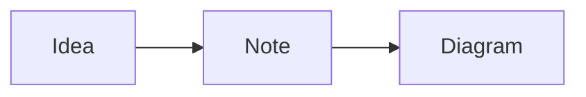

# Formatting Reference
This is where we list the formatting Lockbook supports and how to type it. New to Markdown? Start with [Writing in Markdown](the-editor.md).

## Cheat sheet
| To get | Type |
|---|---|
| **Bold** | `**bold**` |
| *Italic* | `*italic*` |
| Underline | `__underline__` |
| ~~Strikethrough~~ | `~~strikethrough~~` |
| Highlight | `==highlight==` |
| `Code` | `` `code` `` |
| Heading | `# Heading` |
| Bulleted list | `- item` |
| Numbered list | `1. item` |
| Task | `- [ ] task` |
| Link | `[text](https://lockbook.net)` |
| Link to a note | `[[Note name]]` |
| Image | `` |
| A note shown inside this one | `![[Note name]]` |
| Quote | `> quote` |
| Code block | ```` ``` ```` on the lines above and below |
| Table | `\| a \| b \|` |
| Divider | `---` |

The rest of this page covers each of these in more detail.

## Text styles
Wrap text in the style's characters. Styles can sit inside one another:
```md
**Due ==Friday==, ~~not Thursday~~.** Bring *__both__ forms*.
```
A bold sentence with a highlighted word and a crossed-out phrase, then italics with one word underlined.

| Style | Type |
|---|---|
| Bold | `**bold**` |
| Italic | `*italic*` |
| Underline | `__underline__` |
| Strikethrough | `~~strikethrough~~` |
| Highlight | `==highlight==` |
| Code | `` `code` `` |
| Spoiler | `\|\|spoiler\|\|` |
| Superscript | `x^2^` |
| Subscript | `H~2~O` |

## Headings
Start a line with one to six `#`s and a space. More `#`s make a smaller heading.
```md
# Heading 1
## Heading 2
### Heading 3
```

## Lists
Start a line with `-` for a bullet, `1.` for a number, or `- [ ]` for a task. Put an `x` in the brackets to check it off.
```md
- milk
- eggs

1. preheat the oven
2. mix

- [ ] call the bank
- [x] book flights
```
To put one item inside another, indent it until it lines up with the text of the item above.
```md
- fruit
  - apples
1. first
   - a detail
```

## Links
Put the text in square brackets and the destination in parentheses. The destination can be a web address or another Lockbook file.
```md
[Lockbook's website](https://lockbook.net)
[my packing list](../travel/packing.md)
```
To link to a note by its name, use double square brackets. Add `#` and a heading to link to a section, or `|` and some text to show different words.
```md
[[Packing list]]
[[Packing list#Toiletries]]
[[Packing list|what to bring]]
```

## Images and embeds
An image is a link with `!` in front. Pasting or dropping an image into a note writes this for you.
```md

```
Put `!` in front of a double-bracket link to show the file itself: a note, one section of a note, or an image.
```md
![[Packing list]]
![[Packing list#Toiletries]]
![[boarding-pass.png]]
```

## Quotes and alerts
Start each line with `>`.
```md
> The best time to plant a tree was twenty years ago.
```
To turn a quote into a colored alert, make its first line `[!NOTE]`, `[!TIP]`, `[!IMPORTANT]`, `[!WARNING]` or `[!CAUTION]`. Text after the tag replaces the title.
```md
> [!WARNING] Before you travel
> Check that your passport is valid for six months.
```

## Code
For a block of code, put three backticks on the line above and the line below. Name the language after the opening backticks to color it.
````md
```rust
fn main() { println!("Hello, world!"); }
```
````

## Diagrams and math
A code block whose language is `mermaid` draws as a diagram. See [Mermaid's documentation](https://mermaid.js.org/intro/) for what it can draw.
````md

````
Wrap a formula in `$` to set it within a line, or in `$$` to give it lines of its own. Formulas are written in LaTeX.
```md
The area is $\pi r^2$.

$$
x = \frac{-b \pm \sqrt{b^2 - 4ac}}{2a}
$$
```

## Tables
Separate columns with `|`, and put a row of dashes under the header.
```md
| Item  | Price |
|-------|-------|
| Bread | $4    |
| Milk  | $3    |
```

## Dividers
Three dashes on their own line draw a line across the page.
```md
---
```
