# How Lockbook protects you
Lockbook is built so that only you and the people you share with can read your notes. The Lockbook team — and everyone else — sees only encrypted data. It's unreadable to us without the secret key generated for you when you sign up.

## What we *can* see
We see what's necessary for the operation of our sync server and little else:

| We *can* see | We *can't* see |
| --- | --- |
| Your username | Your email, phone number, or real name |
| When a file was last changed, which username changed it, and from which platform and app version | The files' contents |
| How many files you have, how they're organized, and the usernames of collaborators | The names of your files and folders |
| The size of compressed, encrypted files | The files' original size |
| Your subscription's identifiers from the App Store, Google Play, or Stripe | Your billing address or receipts |

Card details you enter on desktop pass through our server to Stripe, and we keep only the last four digits. Like any server, ours sees the IP addresses of devices using it.

## How someone else *could* see
Because Lockbook never sees your notes, if someone wants to gain access, they need to go through you. They could try:
* borrowing your (unlocked) device
* watching you sign in on a new device
* deceiving you into telling them your secret key

Our [account](account.md) page has tips for handling your key safely.

## How it works
Every Lockbook file and folder has its own key, locked by the key of the folder above it, so that access to a folder grants access to everything inside. Your secret key grants access to your root folder. Your collaborators' secret keys grant access to what you've shared — what you haven't shared remains private.

Your secret key is a secp256k1 private key, represented as 24 words from the BIP39 word list. File keys are AES-256-GCM symmetric keys and encrypt both name and content. Shared keys are locked for a collaborator with an ECDH shared secret, SHA-256-hashed into an AES-256-GCM key derivable only by the two of you. Beside the encrypted file name is an HMAC-SHA256, a cryptographic hash of the filename that allows the server to check for file path collisions without allowing it to confirm a guessed file name.

The server checks that every request is signed with an authorized user's key — this signature tells it who is pulling updates or pushing changes. It evaluates which files each user has access to. The server stops delivering file updates to a user whose access is revoked.

## If Lockbook goes away
Keeping your files doesn't depend on us. They're stored in formats any app can open. You can download all of them on any device and export whenever you'd like.

## Check our work
All of Lockbook is [open source](https://github.com/lockbook/lockbook) under the Unlicense. Anyone can read it, run it, change it, or build on it with no permission needed and no strings attached.