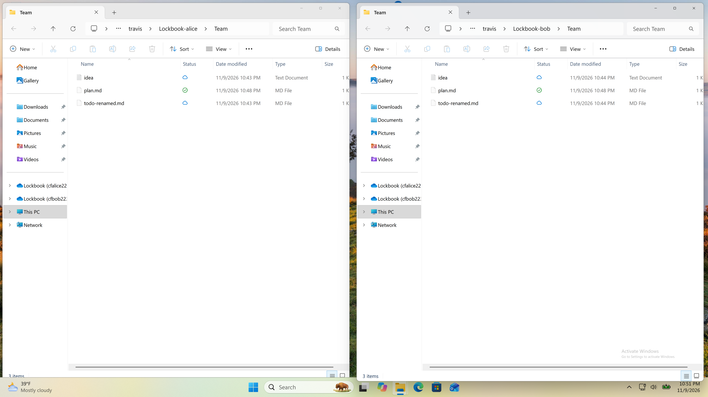
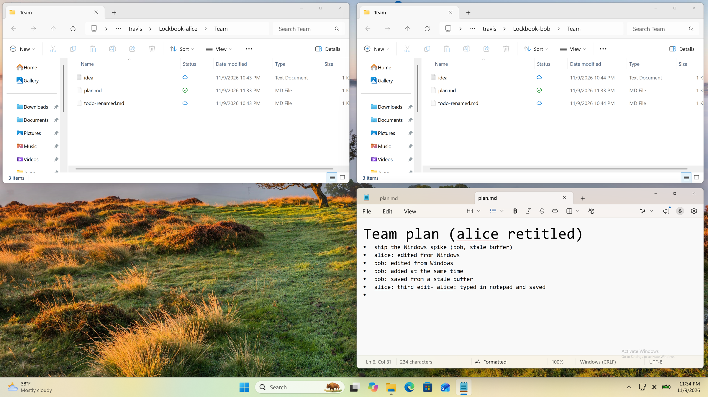

# Windows Cloud Files spike

Lockbook now shows up in Windows Explorer the way OneDrive does. A small helper, `lockbook-cloud-files.exe` ([clients/windows-cloud-files](../../../clients/windows-cloud-files)), registers a sync root for an account. Explorer's nav pane gets a **Lockbook (username)** entry, and every file is a placeholder that downloads when it's opened. On the win11 VM, two throwaway accounts on a local server shared a folder. Edits, new files, new folders, renames, moves and deletes made through the file system on either side reached the other side within one 3 s sync interval. Simultaneous edits merged instead of losing data.

## What was shown on win11

Accounts `cfalice2233` and `cfbob2233` live on the Mac's local server. alice shared `Team` and bob accepted it. Each account has its own data directory (`LOCKBOOK_PATH`) and its own sync root (`C:\Users\travis\Lockbook-alice`, `…-bob`). Scripts and guest logs are in [test-runs.txt](test-runs.txt).

| Step | Result |
| --- | --- |
| Share accepted → folder appears | `Team\plan.md` placeholders created in both roots; nav pane entries registered by `StorageProviderSyncRootManager::Register` (no hand-written CLSID keys) |
| Open a file | FETCH_DATA callback decrypts via `read_document_with_hmac`, Explorer flips the Status icon from cloud to check |
| Edit on alice → bob | append on alice → watcher → `safe_write` → sync; bob's placeholder is dehydrated, next read gets 71 bytes |
| Edit on bob → alice | same path the other way |
| New folder + file, new file | created in Lockbook, converted to placeholders, appear on the other side |
| Rename, move, delete (incl. a folder) | NOTIFY_RENAME / NOTIFY_DELETE callbacks → `rename_file` / `move_file` / `delete_file`, mirrored on the other side |
| Simultaneous edit (alice retitles, bob appends, both save before either syncs) | both edits on both sides: lb-rs's sync merge |
| Real Notepad save on alice | saved in place, reached bob (below) |
| Stale editor (bob saves a buffer opened before alice's edit landed on his disk) | `merged Team\plan.md with a newer version`: both edits kept, via the provider's own three-way merge |

**Real Notepad save.** I typed a line into alice's `plan.md` in Notepad and pressed Ctrl+S. Notepad saves **in place**: the NTFS file id was the same before and after (`…06d57a`), and the file stayed a placeholder. The provider pushed 263 bytes, and bob's next open showed the line about 15 s later. Notepad's Markdown mode also rewrote every `-` bullet to `*` on save. That's Notepad's own formatting, and Lockbook stored exactly what it wrote.

## How it works

- **Sync root and placeholders.** One placeholder per Lockbook file, with the file id as the placeholder identity (16 bytes). Folders are fully populated up front. Files are created dehydrated with their plaintext size.
- **Callbacks** (`cf.rs`): FETCH_DATA, NOTIFY_DELETE and NOTIFY_RENAME. A move out of the sync root (including to the Recycle Bin) is a delete. A rename the helper does itself (from a remote move) is acked without calling lb-rs.
- **Writes and new files.** Windows doesn't call providers for these, so `ReadDirectoryChangesW` feeds a 400 ms debounce. A placeholder that isn't in sync gets pushed. A plain file is created or matched by name, written, then converted.
- **Conflicts.** For each file the helper keeps the bytes it last served or wrote, plus that version's hmac. If Lockbook has moved on since, the save is merged three ways with `Buffer::merge`, the same call the syncer uses for `.md` and `.txt`, then written with `safe_write`. Other types keep both copies (`name (Windows copy)`).
- **Remote changes.** Every 3 s: `refresh`, `sync`, then diff Lockbook's tree against what's on disk. New ids get placeholders, moved paths get renamed, deleted ids get removed, and changed hmacs get `CfUpdatePlaceholder(DEHYDRATE)`. Files with unsaved local edits are left alone.
- **Shared data directory.** The helper calls `Lb::init` on the desktop app's directory (`Config::writeable_path("egui")`). Multi-process safety is db-rs's file lock plus `sync.lock`, as with the macOS extension's `lb_init(..., "file-provider", ...)`.

**Why a helper process rather than the desktop app.** Explorer calls the provider whenever anything opens a placeholder, including when the app is closed. A placeholder with no provider connected fails with "The cloud file provider is not running". macOS solves this with an extension process, and the Windows equivalent is a process started at login. The helper is also small and quick to iterate on: a warm build takes 25 s versus about 20 min for the desktop app.

**New dependencies: none.** The crate uses `windows` 0.62, which is already in the lockfile through the workspace crate; it only adds features (`Win32_Storage_CloudFilters`, `Storage_Provider`, `Storage_Search`, …). I evaluated `cloud-filter` and rejected it for now. Its 0.0.7 release was published on 2026-11-05, four days before this spike, and it's pre-1.0 with a single maintainer. The raw API needed only about 280 lines of wrappers (`cf.rs`).

## Prior art: reused and rejected

- **`origin/lb-bifs`**: reused the push algorithm: `safe_write` against the last-known hmac, and on `ReReadRequired`, `Buffer::merge` of base, local and remote, then write the merge back to disk. Not reused: its whole-tree walk and full-content pull, because Cloud Files gives callbacks and placeholders instead. **Should adopt next:** its on-disk index and base copies. Here the merge base lives only in memory and is lost on restart (see risks).
- **`libs/lb-fs` (NFS)**: rejected. Windows Home doesn't ship the NFS client. Cloud Files also removes the watcher-interplay problem in #2783, since Explorer and other apps see ordinary NTFS files.
- **#1268 (`vfsrs` idea)**: not pursued. FUSE and Cloud Files share almost nothing above lb-rs, so the shared layer is lb-rs plus a small "tree diff to disk" module.
- **macOS File Provider (#5197/#5249)**: mirrored the versioned read and write, per-item ids and periodic sync. Windows has no enumerator, so the remote-changes diff takes its place.
- **WinFsp**: out (C dependency and a kernel driver install). **Nextcloud VFS and the `cloud-filter` examples**: not read during the spike. Unpackaged `Register` worked on the first try, so I didn't need them.

## Open risks

1. **Plaintext size is needed up front.** A placeholder must declare the hydrated size, and lb-rs only knows the encrypted size, so populating the tree reads and decrypts every document. That's fine for a small vault but costs time and bandwidth on large ones. Fix: cache plaintext size by hmac in lb-rs.
2. **The merge base can be wrong.** The base is the last version served to anyone. If another reader (Explorer's preview pane, search indexing) opens the file between an editor's load and its save, the merge treats the editor as having deleted the remote edit. That happened in `t3.ps1` (in [test-runs.txt](test-runs.txt)), where my verification read was the other reader, and the second alice edit was lost. Fix to try: attribute opens to processes with FILE_OPEN_COMPLETION callbacks, or keep every version served since the last push.
3. **A read between sync and placeholder update fails** (`size changed: 99 != 3`). The window is brief, but the app gets an error. Fix: serve the bytes of the version the placeholder describes until it's updated.
4. **No cross-process wakeups on Windows.** lb-rs's IPC is Unix-only, so the helper only sees the desktop app's writes on its 3 s poll. Fix: a named-event or pipe backend for `subscribers/ipc.rs`.
5. **Name mismatches.** Names Windows rejects (`:`, `?`, trailing dot) are skipped silently, and case-only siblings (`A.md`, `a.md`) collide.
6. **Deletes are permanent in Lockbook.** The Recycle Bin is a move out of scope, so a later "Restore" creates a new file with a new id and loses shares.
7. **Large files.** Fetch transfers in one chunk with no progress reporting and blocks the opening app until the download finishes.

## Effort to production (estimate)

About **4–6 weeks** for one engineer:

- Hardening risks 1–4 and persisted bases: 1.5–2 wk.
- Packaging: 1 wk. Run the helper from the existing MSIX: a `windows.startupTask` plus the `cloudfiles:CloudFiles` manifest extension, which also gives a proper icon and uninstall cleanup. Add a setting toggle in the desktop app.
- Context menus (Share, Copy link, Open in Lockbook): 1 wk. These need `IExplorerCommand` via the `windows` crate's `implement` macro, registered in the manifest.
- Custom status (shared or read-only badges via `StorageProviderItemProperties`) and the "files on demand" UI polish: 0.5–1 wk.
- Tests: tree-diff property tests with no Windows dependency, plus a VM QA pass: 1 wk.

A cross-platform demo is now possible: the Linux FUSE spike's accounts live on the same server. I didn't run it, because the Linux VMs were already released and the Mac was saturated.
